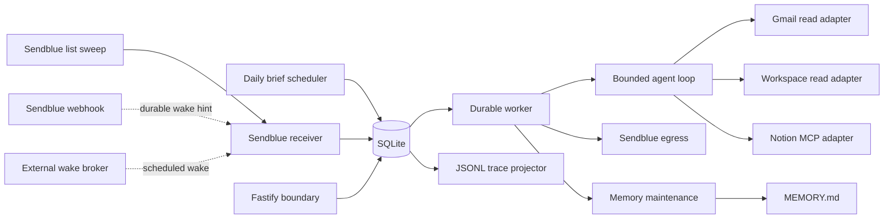

# Architecture

## Scope

This service is a private iMessage assistant for one configured sender. One Node.js 24 process polls the Sendblue Free Sandbox for inbound iMessages, runs a bounded DeepSeek tool loop, accesses explicitly connected Google Workspace and Notion accounts, maintains one local memory document, and sends replies from the configured Sendblue line.

The service does not support group chats, multiple assistant users, arbitrary autonomous schedules, destructive account-provider operations, or generic provider method execution. It supports one fixed read-only daily brief. An optional separate simple-to-do adapter permits explicitly authorized deletion of a task.

## Transport account model

The transport is one Sendblue Free Sandbox line. That plan sets the operating envelope:

- The line number is assigned by Sendblue and shared, so `SENDBLUE_FROM_NUMBER` identifies the line, not an owned phone number. Inbound matching therefore requires the exact sender as well as the exact line.
- Only a contact verified in Sendblue can exchange messages with the line, and that contact must open the conversation by texting the line before the assistant can send to it. Setup is verified-contact first, inbound-first.
- Sendblue delivers receive webhooks for the verified shared-line account. A live callback proved delivery on 2026-09-24. The callback is an authenticated wake hint, never a source of message content. The paged list sweep remains authoritative.
- Sendblue returns no transcription for inbound audio, so voice notes cannot become user input.
- One reply is one send call. Sendblue caps message content at 18,996 characters, and the agent's final answer is bounded to the same 18,996 characters, so the send path always accepts it.

## Process topology

One process owns one long-lived `better-sqlite3` connection and these components:



The public Fastify instance serves `/health`, `/webhooks/sendblue`, `/internal/wake`, signed connection routes, OAuth callbacks, and the Notion client metadata document. The Sendblue endpoint checks the per-webhook secret and exact sender and line fields. The scheduled endpoint uses a separate bearer secret. Both persist a wake obligation before acknowledging it.

When enabled, the authoritative process adds a second Fastify instance bound only to container `127.0.0.1`. It reuses that process's database handle, connection store, signed-link service, and memory store. Railway publishes only the public listener; an authenticated SSH local forward is the sole browser path to account health, new Google connection, and revision-checked `MEMORY.md` editing. The tunnel starts no second assistant runtime.

SQLite, `MEMORY.md`, and projected traces share the Railway volume. Production runs one replica because the queue, worker, and WAL database are one local durability unit.

Before SQLite opens, startup trims projected trace files down to a small emergency budget so a previously filled volume cannot strand the write probe in a crash loop; the spool re-projects any deleted file on demand. Startup then performs configuration validation, SQLite migration and integrity checks, interrupted-write recovery, interrupted-memory recovery, trace retention, freelist-gated SQLite compaction, and pending trace projection, in that order, because projecting first would resurrect files retention is about to delete. While running, an hourly sweep repeats projection and retention, and the WAL carries a size limit. Startup does not contact Sendblue, the configured model endpoint, Google Workspace, or Notion. The receiver, the daily brief scheduler, and the worker start after every configured HTTP listener is bound.

## Inbound message flow

Ingress is a paged sweep driven by durable wake hints, not by callback payloads. `SendblueReceiver` owns it:

1. Read the durable single-row ingress cursor.
2. List inbound messages with `updated_at_gte` set to the cursor, minus a 60-second overlap once the cursor has completed one sweep, ordered by `updatedAt` ascending, 100 per page.
3. Page through the reported total, rejecting a response whose pagination or ordering contradicts the request.
4. Ingest each message, then advance the cursor to the highest observed `updatedAt` for the page.
5. Resolve hints against committed delivery rows. Retry bounded message-list visibility delays, then wait without provider traffic when no hints remain.

Ingesting one message inserts the delivery, inbound message, initial trace events, and durable job in one SQLite transaction. Provider message IDs are unique, so the overlap window re-observes messages already stored and resolves them to the existing delivery instead of creating another inbound message, job, or agent run.

A message is accepted only when its line number and recipient number both equal the configured Sendblue line, its sender number and contact number both equal `USER_PHONE_NUMBER`, it is inbound, it is a one-to-one `message` with no group ID, its service is `iMessage`, and its status is `RECEIVED`. Every other message is recorded as rejected with a reason and never gets an inbound row, a job, or a tool call.

Migration 11 adds `sendblue_wake_hints`. Startup and authenticated scheduled wakes request a recovery sweep. Receive webhooks record a bounded provider-message hint, not message text. A request counter prevents an older sweep from clearing a newer hint. Successful sweeps preserve the existing cursor overlap and deduplication rules. There is no idle five-second poll or event stream. If a webhook is missed or its short visibility retries expire, the next recovery sweep can discover the message from the retained cursor, subject to Sendblue retention.

Sendblue does not transcribe inbound audio. A media-only message therefore arrives with no text, is blocked without an agent run, and produces one `missing_text` failure notice. Safe message metadata records that media was present; attachment URLs are not retained.

## Sleeping and scheduled wakes

`WakeScheduler` publishes the earliest actionable queue, receiver, or deferred daily-brief deadline to the external broker. Receipt-blocked memory jobs do not cause repeated immediate wakes. Completed inbound finalization remains schedulable beyond the ordinary attempt cap. Local worker and daily scheduler loops remain active only while the process is running; they cannot wake a sleeping container.

`deploy/wake-broker.mjs` runs as one SQLite-backed Cloudflare Durable Object. It stores only a wake deadline and retry metadata, not application state or provider credentials. It commits the deadline and alarm before acknowledging `/schedule`, retries failed Railway wakes, and preserves newer schedules received during an in-flight wake. Its hourly cron repairs alarms without contacting Railway. A six-hour UTC fallback supplies missed-message and scheduling recovery. Normal delivery and memory jobs drain while awake; delayed work is included in the published deadline.

Railway Serverless must be enabled. A healthy idle receiver makes no outbound requests, allowing the platform to sleep after its network-idle window. This change does not promise a sub-dollar bill or a fixed cold-start latency. Google adapters import only their used API modules and the direct authentication library rather than loading every Google API, reducing startup memory without changing scopes or provider operations.

## Durable queue

The queue holds five active job types: `inbound`, `daily_brief`, `egress_send`, `egress_reconcile`, and `memory_maintenance`. Jobs use lease tokens and lease expirations. A claim increments its attempt count and sets one random lease token. Heartbeats, completion, requeue, failure, and shutdown checks must present that token. An expired lease can be reclaimed; the stale owner cannot commit afterward.

Only one job for a chat runs at once. Inbound sequence numbers preserve per-chat order, and pending reply sends take priority. Memory work is created only after confirmed delivery and waits for unresolved earlier reply receipts, so older preferences cannot overwrite newer ones. Waiting memory jobs do not block newer inbound messages. Expired running jobs remain ordered by lease expiration so recovery cannot starve. Internal egress and memory jobs are capacity-exempt so a full user queue cannot strand a committed result.

A process stop does not release a lease while its handler may still be running. On `SIGTERM`, the configured HTTP listeners begin draining; the receiver, the daily brief scheduler, and the worker observe one shared abort signal and stop after their in-flight sweep or handler returns. SQLite stays open unless every listener drains successfully. Pending traces then project and SQLite closes. If the platform kills the process first, the lease expires and the durable ingress cursor and queue let the next process resume without losing work.

## Daily brief flow

The in-process scheduler reconciles SQLite once per minute. It creates one `daily_brief` job per Los Angeles calendar date with `available_at` set to 08:00 America/Los_Angeles. The unique `(type, subject)` key makes overlapping passes and restarts idempotent. A missing brief can catch up for two hours after 08:00; after that window, the scheduler creates the next day's job. Scheduling performs no provider request.

A daily brief run points `agent_runs.scheduled_job_id` at the claimed job instead of fabricating an inbound message. It uses the normal bounded agent loop, durable reply planning, egress write intent, delivery reconciliation, and post-delivery memory maintenance.

The production registry remains exactly eight tools. For a daily brief, `AgentLoop` filters the model definitions to `gmail.search`, `gmail.read_thread`, `google.search`, `google.read`, `notion.search`, and `notion.fetch`. The request requires one Gmail search and one batched Calendar, Drive, and Tasks search for each capable Google account. It requires one search for each capable Notion workspace. Contacts remain available on demand but are not part of the daily brief. The completion guard checks each account and product facet by the bound connection and exact safe label. With no healthy source, the service sends connection instructions without calling the model.

When `TODO_API_URL` and `TODO_AGENT_TOKEN` are configured, the iMessage brief prefetches `GET /api/todos?status=open` through the existing traced, bounded todo adapter alongside weather. The adapter also filters out any returned record with a completion timestamp and supplies only title, notes, due date, and priority. This snapshot enters the persisted initial request, so resumed runs reuse it. The website is the only task-list authority; older Notion, Google Tasks, and memory snapshots cannot supply tasks or override live status. Notion still covers other relevant work, and existing per-account source checks remain required. A failed website read supplies explicit unavailable data rather than falling back to another task list. Shutdown cancellation propagates instead of becoming source unavailability. No todo tool is added to the model's six-read allowlist. Without todo configuration, the existing Notion task path remains.

On October 30, 2026, brief trace `tr_7a9385c563bd4b8c9f14c19eac981f89` read Notion and repeated tasks already completed through `todo.complete`; the daily path never read the website. The user's preference to omit previous completions was present in the brief's canonical memory, alongside older preferences naming Notion. The website snapshot and explicit source precedence fix that mismatch. The daily system prompt now permits saved presentation and omission preferences without treating memory as live task status or authorization for tools or writes. No task migration, task mutation, or replay of the original brief is part of this repair.

The handler rechecks the local date and catch-up deadline before any provider work. A daily-origin egress job carries a durable completion deadline and enabled-state requirement. Before opening a Sendblue attempt, the egress handler cancels a still-prepared stale or disabled message and records a confirmed non-write. It never cancels or repeats a write once provider dispatch may have started.

Before a new daily brief run, `src/messages/weather.ts` fetches weather for the selected location. The default is UCLA's campus in Westwood, Los Angeles at `34.0689,-118.4452`. An explicit future-brief weather preference is stored only in canonical `MEMORY.md` as `- Daily brief weather city: City, State/Country`; memory maintenance preserves it on unrelated and one-off weather turns, changes it only on an explicit future-brief request, and removes it on a reset to Westwood. The brief reads this preference before fetching weather. Invalid canonical directives are rejected rather than silently selecting a different city. The selected city's local dates, timezone, Fahrenheit highs/lows and conditions enter the persisted initial request. A resumed run reuses that context. Weather location does not change the morning schedule or its timezone.

UCLA/Westwood uses the [National Weather Service](https://www.weather.gov/documentation/services-web-api) points lookup at the fixed campus coordinates, followed by its validated `api.weather.gov` forecast URL. Neither request depends on Open-Meteo or geocoding. The adapter normalizes NWS daytime highs and nighttime lows into Los Angeles local-date entries; an unavailable half of a partial day is `null`, never an invented temperature. Daytime conditions take precedence when both periods exist. Other named cities still resolve through [Open-Meteo geocoding](https://open-meteo.com/en/docs/geocoding-api) and use its [seven-day global forecast](https://open-meteo.com/en/docs), including non-Westwood US cities. Both provider paths share a five-second deadline and caller cancellation signal, trace each GET before dispatch, and reject redirects. An ambiguous or unknown city returns a clarification error instead of another city's forecast. Provider failures return `weather_unavailable`, letting the brief continue without inventing weather. Replies attribute NWS for UCLA/Westwood and Open-Meteo for other locations. No stale forecast cache is used.

On October 7, 2026, daily brief trace `tr_a3f52b2fcd374f29a4fb96fd66a3c8e5` recorded Open-Meteo HTTP 429 for the fixed campus forecast, then passed `weather_unavailable` to the model. A later read from the production container returned “Daily API request limit exceeded. Please try again tomorrow.” The original response body was not retained, and shared-IP quota exhaustion remains an inference, not a measured attribution. Restoring the independent NWS path removes this quota dependency from the default brief without changing saved-city behavior or retrying the brief.

## Private web brief

The optional web publisher runs alongside the existing iMessage assistant. It does not replace the 08:00 iMessage brief or change inbound behavior. The public Annie repository contains only the authenticated backend. The subscription workflow and Vercel reader live in the separate private `bgar324/annie-brief` repository.

Set all three distinct `WEB_BRIEF_RUNNER_TOKEN`, `WEB_BRIEF_READER_TOKEN`, and `WEB_BRIEF_ADMIN_TOKEN` values to enable the broker. With none set, its routes are absent. The runner can claim work, heartbeat, record network attempts, execute the six daily reads, and complete a run. The reader can fetch only the published edition. The admin credential can seed a dedicated managed ChatGPT session; it cannot authorize provider mutations.

Migration 12 adds a genuine `web_brief` run source and its execution ledger without inventing inbound messages or scheduled jobs. Web runs use the exact production `ToolRegistry` instance. The broker enforces the six-name read allowlist, denies Contacts, binds each execution to its actual account, and checks the same per-account Calendar, Drive and Tasks windows as the existing daily brief. An async execution scope suppresses only that caller's reconnect notices. The shared refresh producer still updates connection health and credentials; ordinary callers can independently plan idempotent recovery after observing the outcome.

The broker owns one encrypted dedicated-CI Codex session. Claim commits exclusive checkout before returning it. A live lease and matching credential generation fence tool execution, attempt recording, checkpointing, and publication. An expired checked-out session requires a fresh login rather than replaying possibly rotated credentials. Completion saves valid final credentials even when the brief fails validation. An exact duplicate completion is idempotent; conflicting or stale completion is rejected.

The private runner pins official Codex 0.165.0. It uses a fresh home, an explicit tool-restricted model catalog, and exactly six host-owned dynamic read tools. Shell, patch, filesystem, browser, app, plugin and agent capabilities are disabled and tested against a synthetic provider. On GitHub Linux, Codex runs as a separate UID whose firewall permits only loopback. A parent-owned TLS proxy forwards only fixed OpenAI destinations after an acknowledged durable trace attempt, including OAuth refresh and bootstrap reads. WebSocket upgrades receive 426 so the native client falls back to audited HTTP. Neither Annie's database/key nor integration credentials leave Railway.

Scheduled publication permits work only from 06:00 through 09:59 Pacific. The private workflow requests generation at 06:47, 07:17, 07:42 and 08:12; a published date is not regenerated. Scheduling is best effort, not an 08:00 delivery guarantee. Model output is bounded structured text with same-run source IDs. Infrastructure supplies source metadata, dates and coverage. The reader renders escaped components, reports stale/partial editions, and keeps its backend token server-side. Vercel Authentication must protect **All Deployments**, including production, before enabling the reader.
 
Migration 13 distinguishes immutable `daily` and `preview` run purposes. Explicit manual previews may run outside the morning window, as approved for on-demand dry runs; this does not authorize out-of-window scheduled publication. `/internal/brief/preview/claim` and `/internal/brief/preview/complete` share the existing exclusive credential checkout, lease fencing, six-read registry and per-account coverage requirements. Completion rejects a purpose mismatch before credential checkpointing. Preview completion returns a bounded versioned artifact, never inserts an edition, and retains only completion metadata. Valid final credentials still checkpoint when the draft is rejected. Exact duplicate completion returns metadata, not another copy of the personal artifact.

In a preview, Codex selects and words at most twenty source-cited to-dos. The backend supplies weather from its sealed forecast snapshot and calendar events from persisted normalized reads, sorted and deduplicated by resource identity rather than title. The private runner encrypts only this artifact for short-lived download. Its localhost renderer keeps the approved painting-led layout and three sections; weekday/date, forecast and calendar are not model-authored. No source/account badges are displayed. Preview circles are local page state, never provider mutations. A forecast high or low must not be presented as an observed current temperature. Scheduled editions retain their existing contract until a separate cutover.

Preview to-do drafts include required `references: [{sourceId, itemId}]`, at most 32 per item, alongside their same-run `sourceIds`. A search batch is not an exact target: its reference must select a returned normalized Gmail message/thread ID or Notion page ID. A single `gmail.read_thread` or `notion.fetch` citation can identify its returned target without a reference. Foreign, uncited or nonexistent references reject the draft while still checkpointing valid rotated auth. No model-authored URL is accepted.

The backend resolves references only from persisted successful reads bound to this web run and their actual connection. Gmail links use a normalized hexadecimal message/thread ID and that connection's verified OAuth email in `https://mail.google.com/mail/u/?authuser=<encoded-email>#all/<id>`, never a browser account index, inferred recipient or display label. Notion links use an actual returned UUID page ID in `https://www.notion.so/<32hex>`, never an arbitrary source URL. Missing routing metadata or usable identity yields no link. Final to-dos contain exactly `id`, `title`, `detail`, `due`, `sourceIds` and bounded `links: [{url,label}]`; draft references are removed. Links are deduplicated with Gmail first so a mixed task opens its actual email. A Notion-only task opens its actual page. The renderer omits the arrow when no verified link exists and does not show inline provenance badges.

Offline end-to-end proof, from this repository after `pnpm build`, with the private companion checkout beside it:

```text
pnpm exec tsx ../annie-brief/scripts/smoke-end-to-end.mjs
```

This runs the actual native Codex app-server, actual HTTP broker, SQLite, registry and adapters against synthetic model/Google/Notion responses. It forces a native OAuth refresh, rejects an invalid edition while checkpointing the new credentials, starts a fresh native process with the rotated session, publishes, and checks date idempotency. It then generates an outside-morning preview and verifies the existing edition is unchanged, with no write intents, sends or jobs. It performs no live provider requests, sends, or mutations. The private repository's `npm test` and `npm run verify:isolation` cover transport boundaries and the pinned capability controls. Actual account eligibility and observed scheduled-morning delivery remain deployment checks, not conclusions from this synthetic proof.

## Agent boundary and limits

The model receives:

- the assistant system policy;
- the complete bounded `MEMORY.md` document;
- bounded recent conversation history;
- safe connection labels, provider names, health states, and capabilities;
- tool definitions allowed for that run;
- normalized tool results.

The model does not receive credentials, provider SDK clients, provider wire payloads, internal connection IDs, provider account IDs, signed connection links, or raw attachment URLs.

Each run has a durable transcript and enforces these bounds:

- 120-second wall-clock deadline by default;
- 90-second timeout for one DeepSeek response, still bounded by the whole-run deadline;
- twelve tool rounds, then one round offered no tools so the turn ends in a reply;
- sixteen tool calls total;
- at most one provider write in one model response; read batches share the total call budget rather than a separate response cap;
- no count on provider mutations per inbound request; no provider mutations in daily briefs;
- eight exponentially backed-off transport attempts for one model request, still bounded by the whole-run deadline;
- 18,996 characters for the final iMessage response, matching the Sendblue content cap.

Internal tool names use dots. The OpenAI-compatible adapter alone converts dots to underscores on the wire and maps returned calls back to the internal names. It stores each assistant wire message as opaque provider state and replays it unchanged so provider reasoning signatures survive tool rounds; core code never interprets that state.

Only the six provider reads explicitly registered as `parallel_read` execute concurrently, bounded by the remaining total call budget. The prompt recommends four reads per response, but exceeding that guidance does not abort the turn. Unmarked reads, both connection-control tools, and writes remain serial by default. Parallel results are persisted back to the transcript in model call order, and individual failures remain isolated.

The September 29 daily brief, trace `tr_0d1fdf49833a45efb9cc4840380268fe`, fetched weather successfully but stopped before executing any of the model's seven tool calls. The former four-call response cap raised `tool_response_limit` and sent a generic failure notice. Removing that separate cap lets larger read batches proceed while preserving the total call budget, deadline, allowlist, per-call guards, and rejection of multi-write batches. The failed brief was not replayed.

The production model is `deepseek-v4-flash` through DeepSeek's OpenAI-compatible chat-completions endpoint; DeepSeek currently routes this legacy name to V4.1 Flash. Ordinary inbound runs explicitly use `low` reasoning. Daily briefs and memory maintenance retain the configured effort, `high` in production; lowering inbound effort does not disable thinking or change either background path. Each assistant wire message is replayed unchanged so DeepSeek `reasoning_content` survives tool rounds. Earlier checks found that disabling thinking missed an explicit future-brief preference during memory maintenance. On October 9, `max` did not resolve a task retry: trace `tr_6203addf93ed46558dd12fe75e438844` spent 51.9 seconds generating its first search, hydrated in 2.5 seconds, then exhausted the 120-second deadline without attempting an edit. A later successful `high` retry used six model calls and five tools: 52.5 seconds in model/loop work versus 5.0 seconds in tools, including two rejected text patches. Source-backed task actions and compact reads remove that copying work instead of asking the model to reason harder. The 90-second response and 120-second whole-run bounds remain unchanged.

Reply shape rules live in the format reminder appended to every model request, not in the identity prompt. After a tool result a reply opens with a relevant emoji, as a header above a list or leading a short answer; standard `• ` bullets mark genuine lists of peer items, while outcomes, answers, and questions stay plain sentences. `normalizeFinalResponse` in `src/agent/loop.ts` repairs a Markdown hyphen before a bullet and, for inbound replies only, strips the prefix from a lone bullet line so a list of one is delivered as prose. The daily brief uses the same standard bullet marker, including in a one-item section. Emoji headers and other tone instructions are unchanged by the marker change. The reminder also forbids narrating tools, turns, scopes, or permissions to the user and caps a failed provider read at one corrected retry.

An inbound turn is one model loop with full context and every production tool. There is no separate authorization step: the model reads the current message against quoted history and canonical memory and decides what to do, including Notion writes. This is a deliberate choice by the user, who accepts the model acting on history for Notion and wants short follow-ups ("try again", "yes", "do it") carried out rather than interrogated; Google stays read-only by OAuth scope regardless of anything the model decides. The identity prompt states the intended reading of history: a short message refers to the most recent unfinished request or Annie's most recent offer and is carried out; a greeting, thanks, or small talk asks for nothing, and earlier requests that went unanswered are not standing orders. The request matrix's `greeting_after_failures` case (eight unanswered old requests, then "Hey annie") measures how well that holds; on removal of the gate it acted on history once in one run before the prompt line, and zero in three after.

Tool argument validation names each violation (`/queries/0 must NOT have additional properties 'account'`) so the model corrects its next call; an opaque "does not match the schema" cost a round in one of three calendar reads. A union reports only the variant the caller aimed at. With `allErrors`, ajv emits every branch, so a `tasks` query with one bad field came back as the calendar branch's complaints - a missing `timeMin`, a forbidden `dueBefore` - and the real fault fell outside the five-issue budget; the model repeated the same call and the read failed twice. `branchScopedErrors` in `src/agent/tools.ts` drops branches that fail on a `const` or `enum`, because the discriminator ruled them out, and among the rest keeps the fewest failures. On the live `tasks_due` case that turned sixteen errors into one and the retry started landing. An optional text filter also accepts an empty string as absent: "no text query" was expressible only by omission, so the model sent `""`, and once told that was too short it invented a word that matched nothing.

History of this boundary, kept because it will be tempting to rebuild: the d658a1a rollout let one full-context model decide everything and a bare greeting revived an old storage task; the repair (55897ab) added a tool-free classifier that saw only the raw current message and froze per-run tool permissions, on the theory that history must never grant a write. That held the line but produced a steady stream of the opposite failure: any short message the classifier could not read ("Try again", a bare page name, "Do you have access to X") became a turn with no tools, and the user got either an empty reply, a failure notice, or Annie composing their own request back to them and asking for it "as one complete message". Bounded exceptions were layered on (answering Annie's delivered offer, retrying after a delivered failure notice, reads always on) and each one closed one shape while the next appeared. The user then chose to remove the gate outright for Notion. The classifier, `agent_runs.request_scope` writes, `ConversationHistoryStore.precedingContext`, and the connect-link scope check at issuance are gone; the `request_scope` column remains in schema 9 as an unused nullable column. The connection-link path keeps its own mechanical guards: at most one `connections.connect` per run, nothing after it, and an already-issued link is idempotent on resume.

`pnpm smoke:inbound` exercises Notion, every Google read product, history-referenced follow-ups, conversation, unsupported requests, connection links, weather preferences, and a two-message burst against real DeepSeek with synthetic providers. Cases and provider doubles live in `scripts/smoke/cases.ts` and `scripts/smoke/synthetic.ts`; no live account writes or iMessages are permitted. Results report pass rate, delivered-answer rate, reply latency, rounds, actual wire reasoning efforts for agent and memory calls, and serialized agent-request bytes. Calls are timed to the last response byte. `--repeat N` measures variance; `--category` narrows the run. Synthetic timings exclude live provider latency and Railway cold starts, so they are not a production SLA. A latency improvement that loses the requested behavior does not pass.

## Production tools

The production registry contains exactly these tools:

| Tool | Class | Scope |
| --- | --- | --- |
| `gmail.search` | Read | Bounded Gmail message search |
| `gmail.read_thread` | Read | Bounded normalized thread content |
| `google.search` | Read | One 1–4 product batch across Calendar, Drive, Contacts, and Tasks |
| `google.read` | Read | One Drive file, contact, or task |
| `notion.search` | Read | Internal Notion search |
| `notion.fetch` | Read | Fetch one Notion object |
| `notion.create_page` | Write | Create one page |
| `notion.update_page` | Write | Update one page |

The account-provider registry has no delete, archive, move, raw request, or catch-all tools. Daily brief runs use the same registry but can execute only the six read tools; a pre-execution policy rejects Contacts search and detail arguments before a provider call.

`connections.list` and `connections.connect` are inbound control tools outside the eight-tool provider registry. Each inbound prompt already contains one safe connection snapshot. `connections.list` reads current SQLite state when explicitly asked about connection status or when that snapshot may be stale; ordinary reads do not spend a model round rediscovering labels. `connections.connect` accepts only `google` or `notion` and returns an opaque confirmation that infrastructure will append a link; it never returns a signed URL. Their calls and results use the normal durable agent transcript, and the model authors the final reply in the following round. Daily brief runs never receive either control tool.

`weather.get` is an inbound read-only utility alongside those control tools, not a ninth account-provider tool. It accepts an optional `city`, such as `"West Covina, California"` or `"Tokyo, Japan"`, and invokes the same `fetchDailyWeather` reader used by scheduled briefs without account selection or authentication. An empty object uses UCLA/Westwood. The read itself never saves a preference: only an explicit request to change future daily briefs reaches canonical memory maintenance. The tool returns normalized Fahrenheit daily forecasts, candidate cities for clarification, or an unavailable/not-found error. Scheduled briefs retain their prefetch and six-tool allowlist, so they neither expose nor dispatch `weather.get`.

The optional `src/todo` adapter adds `todo.list`, `todo.create`, `todo.update`, `todo.complete`, `todo.delete`, and `todo.reorder` only to the inbound registry when both `TODO_API_URL` and `TODO_AGENT_TOKEN` are configured. The account-provider registry stays at eight tools, and neither brief path receives the todo tools. The URL is a fixed origin, never a model argument; configuration rejects partial credentials, embedded URL credentials, non-origin URLs, and unsafe production hosts or protocols. Redirects are forbidden. The server-side bearer token is included in trace and memory secret protection, not tool definitions or model results.

When configured, the inbound prompt routes ordinary task and todo requests to the website, even if canonical memory names an older Notion list. An explicit Notion or Google Tasks request stays with that provider. Without the optional configuration, inbound task routing keeps the existing Notion behavior. Daily brief instructions and tool allowlists do not change.

The adapter validates task JSON at the network boundary and caps response bodies at 1 MiB. Requests and body consumption share the provider timeout and the agent context's abort signal. Existing-task mutations require a UUID and expected revision. Delete and reorder accept only `confirmed: true`, which certifies explicit user authorization, not authorization derived from task content. Reorder sends the exact ordered set of open tasks for one date, including every revision; the website rejects stale or incomplete sets.

Migration 14 adds `todo_mutation` to the durable write-kind constraint without changing existing intents. The adapter prepares an intent and commits `attempting` before its single dispatch, using the intent ID as `Idempotency-Key`. Documented pre-mutation HTTP rejections become `confirmed_failed`; transport failures, 5xx responses, cancellation after attempting, and invalid success payloads become `ambiguous`. No todo mutation can follow a failed or unresolved todo write in the same run, including a fresh model call after a conflict. The normal ambiguity stop and replay write prohibition remain in force.


Gmail is read-only. A search fetches message metadata in order with at most five concurrent requests. A targeted search can hydrate zero to three top distinct threads in the same tool call, bounded to 8 KiB per thread, 24 KiB across hydration, and 120 KiB for the complete search result; a failed hydration preserves the metadata result. `google.search` accepts one account and a closed batch of unique product queries. `google.read` accepts only a Drive file ID, Contacts resource ID, or Tasks list-and-task ID. Calendar searches already return complete bounded event records, so Calendar has no detail-read branch. Drive content reads stream at most 64 KiB of text. Google Docs and Slides export as plain text. Google Sheets export as CSV from the first sheet and report that limitation. Unsupported binary, download-restricted, and client-side encrypted files return metadata without content.

Notion uses one hosted Streamable HTTP MCP session per run and selected workspace, opened on the run's first call and closed, with an explicit session `DELETE`, when the run ends on any path; a refreshed access token opens a new one. Before this, every call paid initialize, tools/list, and close, about 0.4 s of a 0.9 s call. The session reads all advertised tool pages once. The adapter intersects those names with the four allowlisted upstream tools and the workspace's current access, then validates the exact call arguments against the selected tool's live input schema. An incompatible write fails before write-intent preparation or provider dispatch. Schema changes and missing tools fail only the affected call; they do not change connection health or require OAuth reconnection. `notion.search` accepts `hydrate` 0–3: the top results' full text returns in the same tool round as pages in the exact `notion.fetch` shape, bounded to 24 KiB per page and 48 KiB in total, with a failed or oversized page simply absent and the search result never lost. In the matrix a checkbox turn went from search, fetch, update to search, update, one model round fewer.

## Connections and routing

Credentials are encrypted at rest with AES-256-GCM under `CREDENTIAL_ENCRYPTION_KEY`. Safe metadata and semantic capabilities are stored separately from ciphertext. One Google connection can grant `gmail.read`, `calendar.read`, `drive.read`, `contacts.read`, and `tasks.read`. Google connections are keyed by verified OIDC subject. Notion connections are keyed by the authenticated workspace identity.

Each provider tool call selects one connection in one of two ways:

1. An exact safe label names one healthy, capable connection.
2. No label is supplied and exactly one healthy, capable connection exists.

The adapter rejects zero matches as connection-required and multiple unlabeled matches as ambiguous. This is a per-call safety boundary, not a user-facing account picker.

For an unscoped read, the agent uses the safe connection snapshot already present in its prompt. It calls the required read tool once for each healthy capable account with its exact safe label, and those independent calls can run concurrently. The agent merges the results and deduplicates the same underlying item across accounts. It keeps distinct items that happen to share a title. The answer omits account details unless they disambiguate a result or explain a source failure. An explicit safe label scopes a read.

Writes never fan out. The agent asks for a target only when neither the request nor a preceding read establishes one. One connection's refresh or health transition never changes another connection.

Google and Notion token refreshes use credential generations and refresh leases. Concurrent reads in one process join the same in-flight refresh for a connection. A stale refresh result cannot overwrite newer credentials. A crash after refresh dispatch is treated as ambiguous because the provider may have rotated the refresh token; that connection requires browser reconnection instead of an automatic retry.

## Signed browser connection flow

The model calls `connections.connect` for Google or Notion when the user asks for a link, and authors a bounded URL-free preface. At most one connect call is accepted per run, nothing may follow it, and an already-issued link is idempotent on resume, including when an old answered tool call is replayed. Signed URLs never enter model context.

The signed token contains a random identifier, provider, issue time, and expiry. SQLite binds the token hash to its purpose, trace, and optional expected connection. The browser route validates the signature and durable binding before starting PKCE OAuth. Reconnection also verifies that the returned provider identity matches the expected connection before replacing credentials.

Connection and callback routes suppress request logging, disable caching, and set a no-referrer policy so signed query values and OAuth codes do not enter routine logs or browser referrers.

## Provider writes and ambiguous acceptance
The model interprets the current user request, including ordinary task additions, shorthand, and relative dates, against quoted history and memory, and decides what to write. Intent interpretation and accurate wording depend on the model; the runtime enforces every mechanical rule below before dispatch.

`NotionToolService` owns update safety. An update uses the latest complete same-run, same-connection source of the page: a full fetch, hydrated search page, private source behind a compact task view, or the applied source of a succeeded content update. Its safe workspace label and page identity must match. Every attempted hydration starts with a private incomplete marker keyed by the requested page ID. Only an accepted, bounded page with no conflicting returned ID replaces that marker. Failed reads and per-page or aggregate overflows remain incomplete even when their pages are omitted from the visible search result. Source selection happens before completeness validation, so a newer incomplete result cannot fall back to an older complete one. Private search evidence takes precedence per page, not for the whole result; another successfully hydrated page remains usable. Search discovers candidates; it is not an additional authorization step.

General updates accept one scalar property or one bounded exact-text patch. The patch's old text must occur exactly once in the fetched page; unchanged headings or neighboring lines can disambiguate repeated tasks, and one patch may span several lines. Replace-all is unavailable. Full-content replacement remains available for user-requested rewrites after a complete fetch; deciding whether the user requested a rewrite belongs to the model. A succeeded content patch records the page as it now reads under `hidden.page` on its tool row, and `#fetchedPage` treats that as the latest same-run read, so a following patch is proven against the real page: a span the first patch consumed is refused as absent, one it introduced is available. `hidden` is runtime provenance only. `boundedToolResult` strips it from the transcript, because echoing a 10 KiB page after every write grew one production run's prompt from 5.5k to 39k tokens across seven rounds and cost a 50-second round.

For checkboxes, `notion.search` with `hydrate:1, view:"tasks"` or `notion.fetch` with `view:"tasks"` returns section/task refs instead of full page text. `match` is a read-only case-insensitive literal filter over heading paths and task labels; it can expose older targets. Each page projects at most three direct sections and twelve tasks per section within a 6 KiB identity-plus-view budget, reports omissions, and labels document-tail ordering without claiming chronological completeness. Empty ancestors that only organize child sections are context, not insertion targets; empty leaves and parents with their own tasks remain editable. Full normalized source remains under `hidden.page` or `hidden.pages` on the read row. Full reads stay the default; incomplete or unsupported task views expose no writable refs.

`notion.update_page` command `edit_tasks` accepts one to sixteen `append` or `check` changes. The model selects returned refs; `src/notion/tasks.ts` preserves exact source offsets, changes checkbox markers or inserts single-line tasks, and expands one literal source span until it is unique. Both generated patch strings stay within 8,000 characters; an oversized batch fails locally rather than splitting writes or rewriting the page. Refs bind the full source to run, connection, credential generation, page, and target; stale or transplanted refs fail before intent preparation. No cache, issuance table, or second write lifecycle is added. Successful completion durably stores refreshed refs and applied full source together; literal replacement callbacks preserve dollar tokens in user text. Already-satisfied checks prepare no intent. A repeated task label is not an append no-op: the user may request another identical task. Selection still belongs to the model. A known personal list needs no owner question; only sections naming different people require matching the requested owner or user's name from memory. With no match, ask once and write nothing rather than guessing from an account email or rereading the same page.

The compiled planner exercised the original 11,450-byte production page through read-only SQLite, without provider calls or persisted edits. Its task projection was 724 bytes before page identity, with three visible editable sections and 137 omitted. Append, check, unchanged, refreshed-ref, stale-ref, unique-anchor, and literal-byte-preservation paths passed. This proves source handling, not remote provider latency or compare-and-swap protection.

The final real-DeepSeek request matrix passed 45/45 cases with synthetic providers: reply latency p50 3.005 seconds, p95 5.965 seconds; 44/45 delivered ordinary answers, with the remaining case correctly stopping an ambiguous write. Successful task examples took 3.4–5.8 seconds, generally search, one batched update, and a reply; the truncated-source refusal took 14.6 seconds. Actual wire requests used `low` for inbound and `high` for memory, including future-weather preference retention. Earlier repeated task checks passed 27/27; the final unsupported-action repeat passed 6/6 with no mutations. These are smoke observations, not a live-account or cold-start guarantee. Compiled latest-source fencing also passed eight in-memory SQLite scenarios covering read failure, conflicting page identity, individual overflow, and aggregate overflow in full and compact modes, with zero write intents, provider mutations, or network requests.

The October 9 task addition failed locally because three proposed anchors changed straight apostrophes to curly ones and matched nothing, while a shorter anchor matched twice. Initial tool-description recipes required copying `oldText` verbatim and preserving the anchor when inserting a checkbox. Missing text returned `write_target_not_found`; repeated text returned `write_target_ambiguous`. Both remain pre-dispatch errors with corrective guidance; neither changes connection health. A synthetic shared-page retry with repeated headings, straight apostrophes, and trailing whitespace passed three times at `high`, preserving the page byte-for-byte except for the requested checkbox. Its reply latencies were 7.4, 19.3, and 30.1 seconds. Compact source-backed refs now replace anchor copying for task actions; general text patches retain the same unique-match guard.

An identical patch or full-content replacement returns `outcome: "unchanged"` without preparing an intent or contacting the provider. A confirmed mutation returns `outcome: "succeeded"`. These results live in the existing tool and write records, not a second action state machine. A read-grounded already-set answer or natural clarification needs no special response validator.

The loop places no count on mutations per inbound request; the user's explicit list of items is the bound. What remains is everything that made a write safe in the first place: one write per response, same-run page proof for each patch, a unique span, an `attempting` intent before dispatch, and an ambiguous result halting the run with no replay. Invalid arguments, missing source evidence, and other pre-dispatch failures return sanitized tool errors, so the model corrects its proposal. A response carrying several writes executes none of them: each write call is answered with `write_batch` and the rule, any reads in the same response still run, and the turn continues. Several task changes can share one `edit_tasks` call and one write, while distinct mutations still consume separate rounds. The tool round budget bounds how much lands in one turn; when it is spent the turn still ends in a reply, never a failure notice, because that last round is offered no tools and the reminder tells the model to report exactly what its results confirm. Production showed why: four checkboxes were ticked, the run then exceeded a six-round budget, and the user was told "I couldn't complete that request" while the page had already changed.


Every provider mutation follows a write-intent state machine:

1. Persist `prepared` with a canonical request fingerprint.
2. Verify the active job lease and connection credential generation.
3. Persist `attempting` before the network call.
4. Persist `succeeded`, `confirmed_failed`, or `ambiguous` after the result.
For Notion updates and page creation alike, a non-error MCP result is acceptance. The response body is a rendered page view, not a receipt, so its shape and `truncated` flag are not checked; a create reports page ids and URLs only when the body carries them. Only an empty envelope, a queued or wrapped `async_task`, a non-`succeeded` status, or an `error` field keeps the write acceptance-unknown. Transport failures after dispatch remain ambiguous and are never replayed. Create was covered after a production create of a titled page returned HTTP 200 and `tool_completed` yet was reported acceptance-unknown by the create-only receipt schema.


If the process stops while a write is `attempting`, startup changes it to `ambiguous`. The service never automatically repeats an ambiguous write. The related agent run blocks and reports its trace ID.
If a run completed before reply planning committed, recovery resumes idempotent reply planning from its stored response without another model call or prose revalidation. Completed inbound finalization remains reclaimable beyond the ordinary job-attempt cap. Recovery never replaces or repeats a reply whose dispatch may have begun.

Sendblue reply sending uses the same rule. One `POST` send carries the reply, and its returned message handle is the only identifier the service keeps. If the send may have been accepted, the egress row becomes `acceptance_unknown` and the write intent becomes `ambiguous`; the service never issues a second send. A send whose acceptance is known but whose delivery is not is reconciled with bounded `GET` status polls, at most twelve within a 30-minute deadline, ending as `delivered`, `provider_failed`, or `delivery_unknown`. The status codec accepts Sendblue's documented message lifecycle, not only the four values the status endpoint documents: `REGISTERED`, `PENDING`, `ACCEPTED`, and `QUEUED` are pending, `SENT` is sent, `DELIVERED` and `READ` are delivered, `ERROR` and `DECLINED` are failed. A status body that still fails validation is a transient error retried under the same poll budget; only a provider verdict ends a delivery check. Before this, a first poll about 1.5 seconds after send failed the four-value codec as a terminal protocol error and ended reconciliation as `delivery_unknown` with no retry. The rejected bodies were not retained, so their exact shape is unknown; four sampled handles later read back in the accepted nested shape as `DELIVERED`. Over three days 31 of 50 outbound messages ended `delivery_unknown`, the screenshot-confirmed ones among them visibly delivered, and because history includes an assistant turn only for a `delivered` reply, those replies were missing from Annie's context and their memory maintenance never ran.

A typing bubble shows while a turn runs. `TypingIndicatorService.start` fires one Sendblue indicator as soon as the run exists, re-sends it every eight seconds, and returns the stop function the turn calls in a `finally`, so the bubble lives exactly as long as the work, including a resumed run. One indicator does not span a turn: production replies land 22 to 51 seconds after the message, and a single bubble was gone long before the reply. It is not a durable write. The call creates nothing, changes nothing a later read can observe, and its worst outcome is no bubble, so it carries no write intent, is never awaited on the reply path, and cannot block or delay a turn; the first failure of a turn is traced as `typing_indicator.failed` and the loop keeps trying. Schema 10 added a `sendblue_typing_indicator` write kind that the earlier design used; the migration stays because migrations are history, but no code writes it. `provider_writes`, the run's count of the user's provider changes, still excludes every `sendblue_` kind, the reply send included. Read receipts need no code: Sendblue's account-level auto mark-read setting acknowledges each inbound iMessage on the line before Annie polls it.

## Conversation history

Earlier accepted user messages remain in bounded history even when their turn failed or their reply was not confirmed. Historical messages are quoted together as closed context, not emitted as live user requests; only the current inbound has the user role in the contextual loop. Assistant text enters history only after confirmed delivery. Normal replies use the delivered body; delivered connection links contribute only their stored URL-free preface. Unknown delivery does not mean the message definitely failed to arrive.

## Memory

`MEMORY.md` is the only canonical long-term memory. It starts with `# Memory`, is at most 16 KiB, and cannot contain configured secrets or signed connection URLs.

Reply preparation commits the egress row, Sendblue write intent, and send job together. Either an immediately delivered send result or a later delivery receipt enqueues `memory_maintenance` in the transaction that records delivery. The existing unique job identity prevents duplicate maintenance. Failed, ambiguous, and unconfirmed replies create no memory work. Pre-existing queued jobs independently check delivery eligibility before calling the model. A memory failure never retracts or repeats a reply.

The memory job reconstructs the user message, final response, and ordered tool outcomes from the durable run instead of carrying transient context in its payload. One configured-model request, bounded to 45 seconds and ending at least five seconds before the job lease, returns either `unchanged` or a complete replacement document. The service validates a replacement and writes it through a same-directory temporary file, file sync, atomic rename, and directory sync. It records before and after digests plus a unified diff in the trace. The job is idempotent by run ID, and startup resolves an interrupted prepared replacement before reclaiming queued work.

## Traces and replay

Trace events first enter a redacted SQLite spool with a monotonically increasing sequence. JSONL files are repairable projections of that spool. A partial or divergent file is rebuilt atomically from SQLite. Traces are debugging artifacts, not functional state: once a turn fully succeeds — completed run, memory maintenance applied, reply delivery confirmed, no failure notice, open write, or queued work — its trace is evicted immediately when the last job settles, and a clean Sendblue sweep or stream rotation evicts its trace without ever projecting a file. The overlap window re-observes the newest message on every sweep, so a duplicate observation is evicted the same way. Failures, ambiguous writes, and in-flight turns keep their traces until terminal, then age and byte-cap retention — measured in allocated disk blocks — expires them after export.

`pnpm trace -- <trace-id>` renders the chronology and identifies the final failure. `pnpm replay -- <trace-id>` reconstructs the captured transcript and tool outcomes in `mock_only` mode. Replay loads storage configuration only; it cannot load the credential key, decrypt connections, contact a provider, execute a tool, or update application rows.
